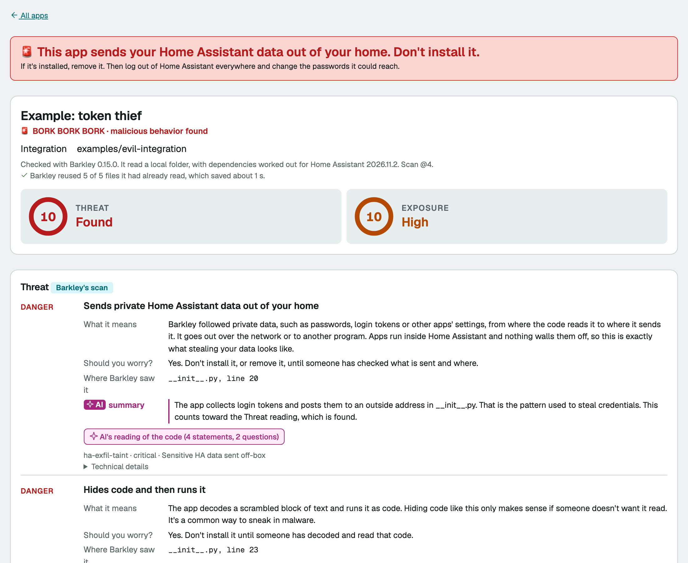
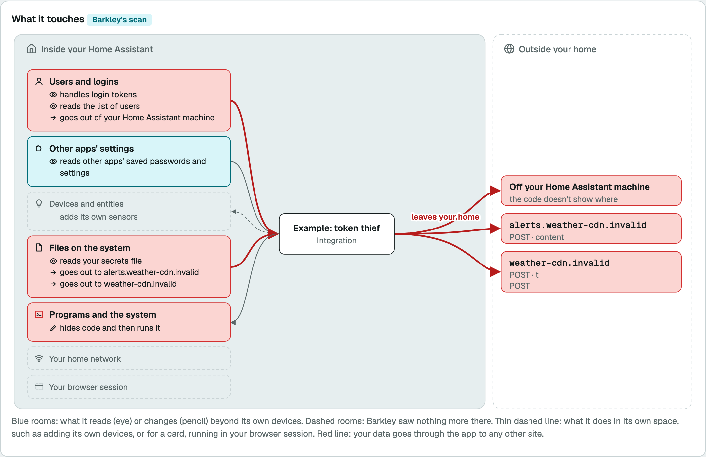
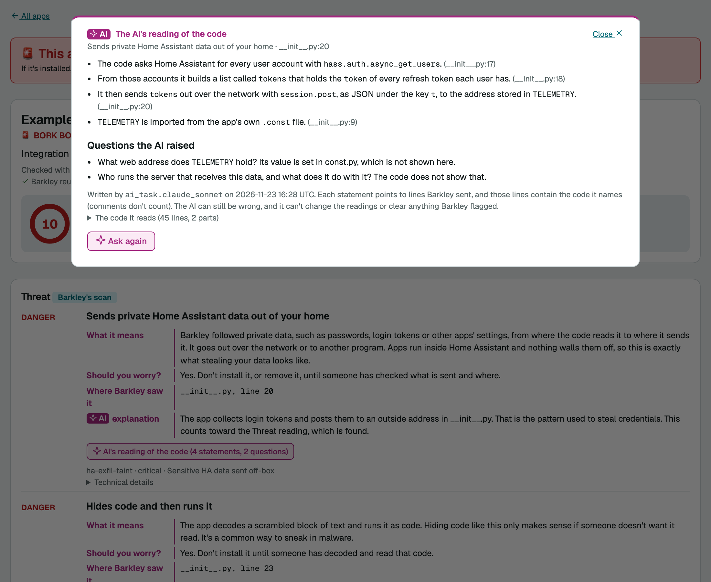

<p align="center"></p>

# 🐕 Barkley

[](https://github.com/SeriesOfTubez/ha-barkley/actions/workflows/ci.yaml)
[](https://github.com/SeriesOfTubez/ha-barkley/actions/workflows/security.yaml)

Every integration gets a sniff test before it gets into the house.

Barkley is the dog behind a static security scanner for Home Assistant Marketplace
(formerly HACS) custom integrations and frontend cards. Custom integrations run
unsandboxed inside the HA Python process; cards run in the HA frontend origin and can
read your tokens. Nobody reviews them before you install. Barkley does a first pass, as
an app (add-on) in your Home Assistant sidebar or from the command line.

Barkley currently checks integrations and dashboard cards only. It doesn't check Home
Assistant apps (add-ons), AppDaemon apps, Python scripts, themes or templates yet.

> **Status:** young, and built by one person. Barkley is a first pass, not a substitute
> for reading the code: a clean sniff means the checks below found nothing, not that
> the code is safe.
> This project was built with AI assistance: see
> [AI-assisted development](#ai-assisted-development) for what that means and what is
> checked before anything ships.

<table><tr><td><a href="docs/images/list-light.png"><picture><source media="(prefers-color-scheme: dark)" srcset="docs/images/list-dark.png"></picture></a><br><sub>The list of installed apps</sub></td><td><a href="docs/images/app-light.png"><picture><source media="(prefers-color-scheme: dark)" srcset="docs/images/app-dark.png"></picture></a><br><sub>An app's page with a found threat</sub></td><td><a href="docs/images/picture-light.png"><picture><source media="(prefers-color-scheme: dark)" srcset="docs/images/picture-dark.png"></picture></a><br><sub>What it touches: the picture</sub></td><td><a href="docs/images/ai-reading-light.png"><picture><source media="(prefers-color-scheme: dark)" srcset="docs/images/ai-reading-dark.png"></picture></a><br><sub>The AI's reading of the code</sub></td></tr></table>

<sub>Screenshots from Barkley's own made-up test apps, not real projects. The AI text is real output from Claude Sonnet 5.5, standing in for the AI Task model you pick; your model's answers will differ.</sub>

## What Barkley does

**Sniff before you install.** Search the whole Marketplace catalog from Barkley's panel
and sniff an app at exactly the version the Marketplace would install, or pick one of
its 10 newest releases, betas included. The code is downloaded and read; it is never
run, built or installed.

**A sniff report per app, with two readings.** Since 0.15 there is no 0–100 score in
the panel. Each app gets:

- **Threat**: signs of malicious behavior only: none found, possible (🐕 Grrrrr) or
  found (🚨 BORK BORK BORK). With none found, the label follows Exposure: 🦴 Good Boy
  (low), 🐾 Needs training (medium) or 🦮 Needs a leash (high).
- **Exposure**, from 0 to 10 (Low, Medium or High): what the app opens up to someone who
  isn't an administrator. Pages that skip Home Assistant's login, login tokens it may
  hand out, published vulnerabilities in its libraries, and code a card loads from
  another site or takes from the page address while it runs. It depends on where your
  Home Assistant runs, which you set once.

Everything else Barkley finds is context. It's listed in plain words and it isn't
scored: what the app can do, a picture of what it does in your home, where the login
you gave it goes, where it connects, where its code comes from, privacy notes, and the
developer's security habits. A custom integration already
runs unsandboxed inside Home Assistant, so what its code openly uses says little about
whether it's trying to hurt you. Barkley gives you the facts and scores only the two
things above. How both readings are worked out is in
[Checks and readings](docs/Checks-and-scoring.md).

**See what you already have.** Barkley asks the Marketplace what is installed and leads
with what needs a look: a found or possible threat, High exposure, a check that didn't
finish, or an update that brings a change to check. The counts at the top are filters,
the list shows as cards or a table, and Sniff again (on each app, or for all of them)
runs fresh scans.

**Auto-sniff, on by default.** When the Marketplace installs or updates an integration
or card, Barkley sniffs the version that landed and sends a notification (the bell,
your phone if you pick a notify service, either, or none). When the Marketplace starts *offering* an
update, Barkley sniffs that version right away, so the heads-up comes before you click
Update. Notifications carry the two readings, counts and the app's name, never text
taken from the scanned code. One thing to know: Home Assistant runs a new integration
as soon as it is installed, so the protection for a brand-new install is sniffing it
from search first.

**"What would updating change?"** Barkley compares the version you run with the one you
would get and puts the few changes that matter first: new threats and other new items,
new data flows, new publishers, sites the app doesn't account for, a release commit that
is no longer signed. Smaller changes, such as a new kind of request to a site or a new
environment variable, are listed under them. The comparison never changes a reading.

**Advisories asked again every day.** A scan keeps the exact package list it resolved,
and once a day Barkley asks the advisory database about it again, without fetching or
scanning any code. A newly published vulnerability in a dependency of something you
installed months ago becomes a new scan entry and a notification. Earlier entries are
never edited.

**Every block says where it comes from.** On an app's page each block is tagged
**Barkley's scan**, **The developer's words** (a description quoted from the code) or
**AI**. The developer's words, and the AI's summary of them ("AI
inferred"), are never shown beside a found or possible threat. Nothing from the
developer or the AI changes a reading.

**Where its code comes from.** What the Marketplace installs, the project and whose
account it is under, who published this release and the earlier ones, how the release's
commit is signed, every Python package Home Assistant would install for it (the ones
that come along included), the npm packages a card is built from, the published
libraries copied into it, and code it gets while it runs. None of it is scored.

**The developer's security habits.** Whether the project runs security scanners in its
own workflows or through commit hooks (pre-commit, lefthook, husky), has Dependabot or
Renovate and a security policy, how many dependency updates are waiting, and open issues
that look security-related. It is context from public signs and never changes a reading.

**If you think Barkley got something wrong.** **Report a false positive** under every
item opens a pre-filled public issue on this repository for you to finish and submit.
There is nothing to accept or mark as reviewed: reviews, "Malware check only" and
"Addresses you trust" were removed in 0.15, because they no longer changed anything
Barkley shows.

**A Settings page.** Where Home Assistant runs, whether minor items are shown, how much
a malicious build tool counts, when a project counts as quiet, auto-sniff and which results notify you, AI, how many scans run at once and how
much memory they may use, published libraries, the cache and the GitHub token, each
with Barkley's default.

**AI explanations, if you want them.** Pick one of your Home Assistant AI Task entities
and Barkley can explain what a scan found, or (in the Explain and read code mode) read
the code around one item and answer with statements that must cite the lines they rest
on. In that mode it can also sum up what the developer's README and code descriptions
say the app does, tagged "AI inferred". Nothing is sent until you click, and only what
the scan found and code and text from the public project are sent, never anything from
your Home Assistant. The AI never sets, clears or changes a reading or an item: those
come from fixed rules. **The explanations are only as good as the model behind the
entity you pick**, and they can be wrong.

**Built for a small box.** Barkley checks free memory before every scan, warns under
2 GB and by default won't start a scan with under 1 GB free (Settings → Low memory), so
a scan can't push Home Assistant out of memory. A
Diagnostics page shows each tool, the memory figure and the AppArmor profile in use.

The [docs](docs/README.md) walk through every feature, page by page. They're also on
[the website](https://ha-barkley.github.io/docs/). The app's own
[documentation](addon/sniff_test/DOCS.md) has the details: every option, how auto-sniff
and the AI features work, and what the app is allowed to do.

## Install on Home Assistant

Barkley runs as an app (add-on), so it needs Home Assistant OS or Supervised.

1. Settings → Apps → the app store → ⋮ → Repositories, and add
   `https://github.com/SeriesOfTubez/ha-barkley`.
2. Install **Barkley**, start it, and open it from the sidebar.

The app store downloads a prebuilt image (amd64 or aarch64, about 200 MB). Most scans
need under 0.5 GB of memory. Across the 6,753 Marketplace apps Barkley scanned in
November 2026, 99 in 100 needed under 1 GB, 18 needed more than 1.5 GB, and the biggest
about 8.5 GB.

**Home Assistant Container or Core, or a small box?** The same image runs as a container
next to Home Assistant or on another machine, with a login through Home Assistant:
[`standalone/compose.yaml`](standalone/compose.yaml) and the docs page
[Standalone (no Supervisor)](docs/Standalone.md).

## What gets checked

- **Code** (Semgrep, bundled HA-specific rules): token and data exfiltration, encoded
  payload loaders, auth internals, other integrations' credentials, unauthenticated views.
- **Python dependencies** (integrations): the `manifest.json` requirements are resolved
  the way HA installs them (HA's constraints, its Python version, PyPI plus HA's wheel
  index) for both x86_64 and aarch64 HA OS / Container. Then: typosquats (offline, from
  the name alone), VCS/URL requirements, brand-new packages, known vulnerabilities and
  known-malicious packages (osv-scanner), for every package HA doesn't already ship.
- **npm dependencies** (cards): the repo's lockfile, checked with osv-scanner. Known
  malware is reported for every package; CVEs only for packages bundled into the card,
  not for build-only tools. A CVE in browser code is rated by GitHub's rating (else CVSS),
  at most high; one that can only slow or stop the page is at most medium.
- **Published libraries** (integrations): a JavaScript file of 64 KB or more that is byte
  for byte a file of a well-known npm package (published at least 30 days ago, 10,000
  downloads a week, no malware advisory), asked from jsDelivr by its SHA-256, isn't read
  as code: it's listed and checked for advisories instead. No answer means the file is
  read. Off on the Settings page or with `--no-library-lookup`.
- **Endpoints**: every host and IP literal in the shipped code, grouped as sites its files
  link to (its `manifest.json` or `package.json`; on code hosting only when every address
  is under the repository owner's path), sites named like the app (Barkley doesn't say
  who runs those), servers the developer runs (free app hosting, only when the address
  carries the repository owner's or the repository's name), local, infrastructure, or
  other sites. Paste sites, request catchers, tunnels, chat webhooks
  with a baked-in token, and URLs with a hardcoded public IP are reported. A shipped
  list (`src/sniff_test/data/known_services.txt`) names who runs well-known hosts as a
  hint; it is matched locally and no host is ever sent anywhere to be looked up.
- **Possible exfiltration**: reading secrets, auth data or other integrations'
  credentials *and* being able to send data to a site the app doesn't account for is a
  possible threat, even when the read and the send are in different files. An address
  that only appears in a list of sign-in return addresses (OAuth), and that no code
  sends anything to, doesn't count as such a site.
- **The developer's `disclosure.yaml`** ([the spec](https://ha-barkley.github.io/disclosure/)):
  shown beside the scan, with where the two don't match (sites, encryption, telemetry,
  pages without a login). It never changes a reading. Only version 1 files up to 64 KB
  are read, and YAML anchors, aliases and tags are refused.
- **Requests** (integrations and cards) **and environment variables** (integrations):
  for each request the code sends, the method and the names of what goes into the body,
  the headers and the address, and which environment variables the code reads and
  sets. Names only, never
  values. These are facts on the app's page and aren't scored.
- **Code you can't read**: compiled `.pyc` files that HA's Python would run instead of
  (or without) the `.py` next to them (unchecked-hash, checked-hash matching the source,
  or sourceless bytecode for HA's Python version), and native `.so` extension modules
  HA's Python would load, either in place of a same-named `.py` or with no source at all.
- **Scanner evasion**: `<!--` and `-->` hide the rest of a line from Semgrep in JS but are
  ordinary code in the ES modules HA loads. Barkley rewrites them (with the same
  meaning) in its copy before scanning, and flags a real `<!--` in code.
  It also rewrites forms Semgrep misreads (`n?.5:1`, `new as(...)` for a class minified
  to the name `as`, and class static blocks, `static { … }`). A code file Semgrep still
  can't read at all is listed on the app's page under "What Barkley couldn't read".
- **Repo signals**: ownership transfers (proven from GitHub's redirect, or from the
  repo's own old links resolving to the same repository), rated by whether the people
  publishing releases changed; a first release by a new publisher; very new repos;
  release tags whose commit isn't on the default branch; release zips whose code
  differs from the tagged source; and how the release's commit is signed.

The JSON report also carries a `graph` section (what the item hooks into: HA
services, views and events, the user's data, hosts, packages, publishers, with an
evidence level on every edge) and a `provenance` section (release timeline,
publishers, former names). Neither affects a reading.

### The two readings

| Threat | Shown as | Means |
|---|---|---|
| 0 | none found | no signs of malicious behavior |
| above 0, under 7 | 🐕 Grrrrr · possible | a possible sign of malicious behavior |
| 7 to 10 | 🚨 BORK BORK BORK · found | malicious behavior found |

| Exposure | Shown as |
|---|---|
| under 2 | Low |
| 2 to under 5 | Medium |
| 5 to 10 | High |

Both are worked out by fixed rules from what the scan found, and the same scan always
gives the same readings. A found threat sets Exposure to 10. A scan that didn't finish
(a missing tool, a timeout) says so beside its readings, and Threat reads "None found so
far".

The old 0–100 number is still in the JSON report (`score`) and in the command line's
output, as the **capability score**: it counts what the code openly uses, and it isn't a
judgment.

## Safety model

The scanned code is treated as hostile. Barkley never executes, imports, builds or
installs it. Archives are extracted into a fresh temp dir outside this repo with
zip-slip, symlink and size protections, and in-tree `.semgrepignore`/`.gitignore` files
are removed so a repo can't hide files from the scanner.

Dependencies are resolved with `uv pip compile --no-build` (wheels only), so no
`setup.py` or build backend ever runs; packages that only ship source archives are
downloaded and extracted, never built. When an integration hands the login you gave it
(or an address) to a library it requires, Barkley downloads that library's wheel (the
exact version, checksum checked, at most four per scan and 40 MB each) and reads it as
text, one level deep. It never installs, imports or runs it. Manifest requirements are validated before uv sees
them, so a manifest can't smuggle in installer options like `-e` or `--index-url`.
Lockfiles are scanned in isolation with Barkley's own osv-scanner config, so a planted
`osv-scanner.toml` can't hide a malicious package.

## How Barkley itself is secured

A security tool that reads hostile code should be held to its own standard. Three
layers, each of which you can check in this repository.

### The app on your box

- **One permission.** The app asks for the Home Assistant API and nothing else: no host
  network, no open port, no Supervisor role, and no access to your configuration folder,
  so `secrets.yaml` and the auth storage are out of its reach. What it uses the API for
  is a fixed list of calls, named one by one in the
  [documentation](addon/sniff_test/DOCS.md#permissions).
- **Its own AppArmor profile, enforcing** (`addon/sniff_test/apparmor.txt`, Home
  Assistant security rating 8). Every process in the container can run only the tools
  the image ships and open only ordinary network sockets (no raw sockets, no
  capabilities). Barkley writes only under `/data` and `/tmp`; the start-up system the
  container runs on (s6) also writes its own folders under `/run` and `/etc`. Nothing
  downloaded is executable. Where the kernel has no Landlock, the scanner tools run in a
  narrower profile of their own, `tools`: no `/run`, no writes under `/etc`, no options
  file, token or scan store, and writes only to `/tmp` and the cache. A hole in one of
  the parsers that read hostile code is confined to that.
- **Each scanner tool in its own sandbox, where the kernel has Landlock**
  (`src/sniff_test/sandbox.py`). Every run of Semgrep, osv-scanner or uv can
  write only that scan's own folder, read the image and the system but not the scan
  store, the token or other scans, run only what the image ships, and connect only to
  port 443 (Semgrep: nowhere). It also can't read Barkley's environment, or signal it
  (on Linux 6.12 or later). Barkley sets this up itself, so it applies on top of the
  app's main AppArmor profile (in place of `tools`) and on its own when Barkley runs [standalone](docs/Standalone.md),
  which won't start without it unless you say so. Home Assistant OS's kernel is built
  without Landlock (checked on 6.18), so there the `tools` profile confines the tools.
  Diagnostics says which.
- **The panel** answers only Home Assistant's ingress, which handles the login, and it
  ships no JavaScript at all: its content security policy allows no scripts, only the
  page's own styles, images and fonts.

### Where the image comes from

`.github/workflows/build.yaml` builds the image when a release is published, on
GitHub's runners, from `scripts/stage_addon.py`'s output (the app's files plus the
scanner's source, never the tests or the malicious samples). The Dockerfile pins every
tool's version: uv and osv-scanner are release binaries checked against a sha256,
Semgrep is installed from wheels only (nothing is compiled), and the
scanner's own dependencies are installed with hashes required. The base image's
signature is checked before the build, the workflow's actions are pinned to commits,
and a version that is already published is never overwritten.

Each image is signed with [Cosign](https://docs.sigstore.dev/) by that workflow. Home
Assistant doesn't check app signatures, so there is nothing you have to do; if you'd
like to check the signature yourself:

```sh
cosign verify ghcr.io/seriesoftubez/barkley:0.15.0 \
  --certificate-oidc-issuer https://token.actions.githubusercontent.com \
  --certificate-identity-regexp '^https://github.com/SeriesOfTubez/ha-barkley/'
```

To build it yourself instead: `uv run python scripts/stage_addon.py`, then
`docker buildx build dist/addon/sniff_test`, or install the staged folder as a local
app (see the app's documentation).

### Checks on every change

`.github/workflows/security.yaml` runs on every push and pull request, and once a
week. The `main` branch only takes changes that passed it and the tests.

| Kind | Tool | What it reads |
|---|---|---|
| Secrets | Gitleaks | every commit |
| SAST | Semgrep's registry rules, CodeQL | the scanner's code and the workflows |
| SCA | Trivy | the lockfile, plus an SBOM |
| IaC | Checkov, Hadolint | the Dockerfile and the workflows |
| Container | Trivy | the image built from the staged folder: CVEs that have a fix (high and critical), configuration, plus an SBOM |

A finding fails the run. Anything accepted is written down with its reason:
`.checkov.yaml`, `.hadolint.yaml`, `.trivyignore` (empty today). The malicious samples
in `tests/` and `demo/` are left out of the code and dependency checks, since being
caught is their job.

## AI-assisted development

Barkley was built with AI pair-programming assistance (Claude, via Claude Code) under
human direction and review; most of the code and docs are AI-generated. If that's a
dealbreaker for you, that's a reasonable position, and this project isn't for you.
Here's what's in place either way, so you can judge for yourself rather than take it on
faith:

- **Security scanning runs on every push and pull request** (the table above, and the
  badge at the top of this page).
- **Those scans have already changed real decisions.** Before the first release Trivy
  found 31 high CVEs in the image: osv-scanner moved up a version, a base-image binary
  nothing used was removed, and the image now takes Debian's security fixes at build
  time.
- **The detection rules are tested**: each rule has annotated test code, the planted
  malware in `tests/fixtures/` must be caught on every run, and a new rule is tried on
  real integrations and cards for noise before its severity is settled.
- **All source is here to read**; nothing is obfuscated or minified. Issues and pull
  requests are welcome, especially reports of a missed detection or a false alarm. AI
  assistance doesn't put the code beyond scrutiny: it means you get to scrutinize it.

## Command line

```sh
uv run sniff-test scan https://github.com/owner/repo            # latest release, as HACS installs it
uv run sniff-test scan owner/repo --ref v1.2.3                  # a specific tag
uv run sniff-test scan ./path/to/repo                           # local checkout
uv run sniff-test scan owner/repo --exposure public             # HA reachable from the internet
uv run sniff-test scan owner/repo --json -o report.json         # machine-readable report
uv run sniff-test scan owner/repo --ha-version 2026.10.2        # resolve deps for a specific HA release
uv run sniff-test scan ./path/to/repo --offline                 # no PyPI/OSV lookups (marked incomplete)
uv run sniff-test scan owner/repo --no-cache                    # read every file again (no cache of code already read)
uv run sniff-test scan owner/repo --no-library-lookup           # read every JS file; don't ask jsDelivr
uv run sniff-test scan owner/repo --fail-on possible            # exit 3 on any sign of malicious behavior
uv run sniff-test scan owner/repo --fail-on found               # exit 3 only when malicious behavior is found

uv run sniff-test diff old.json new.json                        # what an update changes (reports from scan -o)
uv run sniff-test diff owner/repo --from v1.2.3                 # scan v1.2.3 and what HACS installs now, compare
uv run sniff-test diff owner/repo --from v1.2.3 --to v1.3.0 -v  # two tags; -v lists every change
uv run sniff-test diff owner/repo --from v1.2.3 --ha-version auto  # old side: the HA of its time
uv run sniff-test releases owner/repo                           # release timeline: HACS default, publishers, handovers

uv run sniff-test scan owner/repo --store scans.db              # also keep the scan in a SQLite scan store
uv run sniff-test diff owner/repo --from v1.2.3 --store scans.db  # reuse a matching stored scan, store new ones
uv run sniff-test diff @3 @7 --store scans.db                   # compare two stored scans
uv run sniff-test history --store scans.db                      # list stored scans (or set SNIFF_TEST_STORE)
uv run sniff-test serve --store scans.db --allow 127.0.0.1      # the add-on's web panel (HA ingress)
```

`scan` prints the two readings first, then the capability score. `--fail-on` replaced
`--fail-under` in 0.15.

`diff` puts the few changes that matter first (new items, new data flows, evidence
going from possible to proven, new publishers, new sites the app doesn't account for) and
summarizes the rest in one line. It compares; it never changes either scan's readings.

## Requirements

Python 3.14, [uv](https://docs.astral.sh/uv/), and on `PATH`: `semgrep` and `osv-scanner`
(v2). A missing tool marks the scan incomplete. A GitHub token
(`GITHUB_TOKEN`, or a logged-in `gh`) avoids API rate limits. HA release data and the
resolved package sets are cached in `~/.cache/sniff-test/` (override with
`SNIFF_TEST_CACHE`).

## Development

```sh
uv sync
uv run pytest                 # unit + rule tests + planted-malware fixtures
uv run pytest -m network      # opt-in tests that hit GitHub / PyPI / OSV
uv run ruff check . && uv run ruff format --check .
semgrep scan --test --config rules/ tests/rules/
```

Rules live in `rules/` (Semgrep YAML) with annotated test targets in `tests/rules/`.
`tests/fixtures/` contains deliberately malicious sample repos. They are never executed
and only send to `.invalid` hosts. To report a security problem, see
[SECURITY.md](SECURITY.md). MIT licensed.
