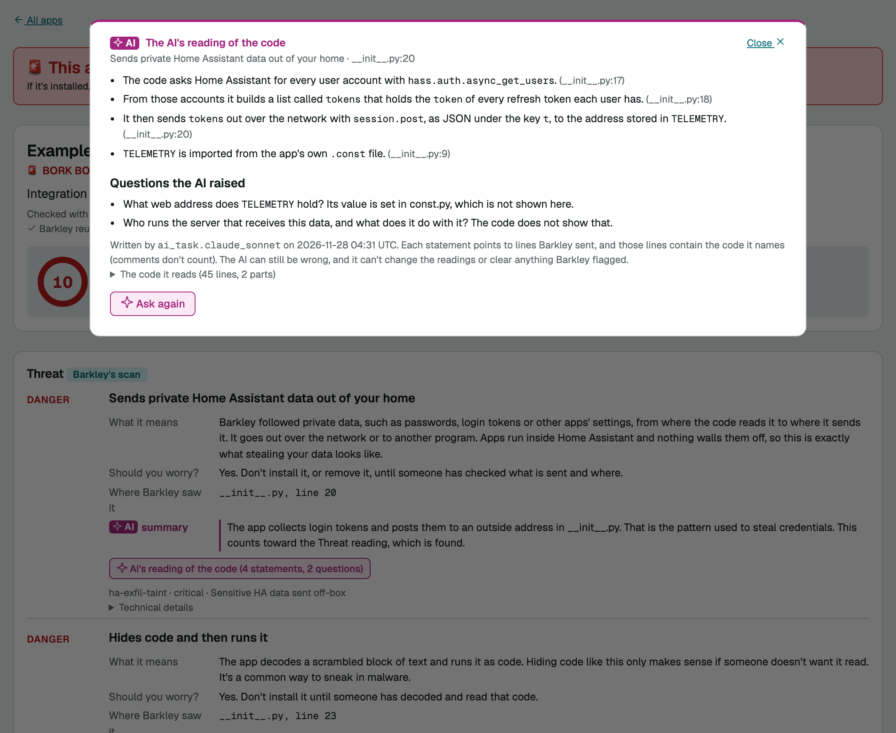

# AI explanations

AI explanations are optional. Barkley works without any AI, and both readings come from fixed rules.

**The explanations are only as good as the model behind the AI Task entity you pick, and
they can be wrong.** In testing, GLM 5.3 and GLM 5.3 Flash both gave good results.

## Setting it up

On any app's page, or on the Settings page, pick one of your Home Assistant AI Task
entities from the dropdown, and choose the mode: **Explain only** or **Explain and read
code** (the default). The choice made in the panel wins over the `ai_entity` and
`ai_mode` options.

Everything from the AI is tagged **AI** or **AI inferred** on the page, and none of it
changes a reading.

The model must support structured output (an answer in fields Barkley names). A model
without it fails with an error on the page.

<picture><source media="(prefers-color-scheme: dark)" srcset="images/ai-reading-dark.png"></picture>

Screenshots from Barkley's own made-up test apps, not real projects. The AI text is real output from Claude Sonnet 5.5, standing in for the AI Task model you pick; your model's answers will differ.

## Waiting for an answer

How fast an answer comes depends on your model and how busy it is. The same request can
take seconds one time and minutes the next. While your AI answers, the app's card on
the list has a moving outline in the AI's color, the box at the top of the list names
the app, and the app's page shows how long it has waited, with a **Stop waiting** button.

Settings → **AI time limit** decides how long Barkley waits: 6 minutes by default, or
"Wait as long as it takes" for a slow model on your own machine. When the time runs out,
the page says so; nothing changes a reading. Home Assistant may still finish an answer
Barkley stopped waiting for, but Barkley won't use it. Barkley sends AI requests over
Home Assistant's websocket, because a request through the Supervisor's API ends after
5 minutes.

## Explain this app

Each app's page gets an **Explain this app** button, in both modes. Nothing is sent until
you click it. Barkley then sends the two readings and their reasons, up to 12 of the
scan's items (the rule, the file and a short code excerpt from the public project that
was scanned), and the checked statements of any earlier Explain in context on this app.
A severity goes along only for a threat or a known vulnerability in a library. The answer
is shown as plain text labeled **AI summary**: one for the app under "In short", and one
under each item it explains, next to the fixed explanation. Explain in context (below) is
a separate, deeper request about one item.

## The developer's description (AI inferred)

New in 0.15, in the **Explain and read code** mode only. The same click on **Explain this
app** makes one more request. It carries what the scan stored of the developer's own
words, with their line numbers: the start of the README, the README passages about
logins, accounts, where data goes, privacy and what the app runs on the system, and the
descriptions in the code (docstrings, and the comment block above a function). That's
at most 6,000, 12,000 or 18,000 characters (Settings → AI answers; 12,000 by default),
one description from the code per 1,000 characters, and the README gets at most 60% of
it when there are descriptions. Barkley's own list of what it found goes
along. It doesn't follow links to other repositories.

The AI may write up to four sentences at 6,000 characters, and up to six at 12,000 or
18,000, on what the developer says the app does. Each must
end with the lines it rests on. Barkley shows a sentence only if:

- the cited lines were sent, and have text on them;
- every code name the sentence puts in backticks is on those lines;
- at least three of its longer words are on those lines, so citing some unrelated real
  line doesn't carry a made-up statement;
- it gives no verdict (safe, fine, secure, no problem and the like).

A shown sentence is tagged **AI inferred**, with the lines it cites. Barkley places it by
those lines, not by the AI's choice: under an item only when it cites the file where
Barkley found that item. Sentences that cite only the README, or no item's file, go under
**In short**, as **The developer's description**. The page says plainly that the developer wrote those lines. Barkley checked that each line exists and holds these words, but it can't check whether they're true. A README can
describe a harmful feature in friendly words.

Limits that are always on:

- **A threat was found:** this request is not sent, and nothing of it is shown.
- **A possible threat:** the descriptions on the threat and on the logins it could take
  are not sent, and neither is any description that covers a whole file. Only a sentence about another listed item is kept, and the box of its
  own isn't shown.
- Nothing from it is read by the readings, the list or a notification.
- If this second request fails, the explanation from the first is kept, and the page
  says the AI didn't answer this part.

## Explain in context

In the **Explain and read code** mode (Settings → AI mode; the default). Each item, each
port and each address the app doesn't account for (its files don't link to it and it
isn't named like the app) gets an **Explain in
context** button. During the scan Barkley keeps the code around it, and you can open it under
"The code it reads" before you click. On your click, that code and the question go to
your AI.

A privacy note (telemetry, analytics, a server the developer runs, unencrypted
addresses, MQTT without encryption) shows the button, or the AI's reading, of the
address or port behind it. It's the same reading as under "Where it connects". A note whose addresses are all linked from the app's files or named like it has no reading, and says so.

What the code is, for an integration: the function the item is in; the functions
and classes of the app that it calls or refers to, starting with the ones named on the
flagged line (at most 150 lines together); and the import lines and constants behind the
names used (at most 40 more lines, plus the blank lines between them). For a dashboard
card it is the lines around the item in the bundle.

### When the AI asks to see more

For integrations, the AI may ask once to see more of the app's code. It can only pick
from a list of names Barkley offers (functions, classes, methods and constants of the
app, at most 40 names, three picks). It can't name a file path, and anything that isn't on the list is ignored, because code from a scanned project can contain text aimed at the AI, and that text must not decide what Barkley reads. When the AI writes its pick as a sentence,
only the names in backticks or quotes that are on the list count. Barkley adds the code
it picked (at most 150 more lines) and asks again. The sheet then shows the checked
statements of both readings together, and the questions of the second. A statement of
the second reading that says again what one of the first said (the same code names, on
overlapping lines) is shown once, and the sheet says how many it left out. Your one
click covers both requests, the sheet says what the AI asked for, and the added code is shown under "The
code it reads". When the AI asks for something that isn't on the list, the sheet says
how many such asks were ignored and shows what they were (each cut to 60 characters).
There is never a third request.

To do this without downloading anything on your click, Barkley keeps a compressed copy
of an integration's Python files beside its scan: one copy per version, for the
installed version and an update that is waiting. Copies of older versions are deleted
(their scans stay), a copy of an app you only sniffed from search goes when its scan
ages out, and an app whose Python is over 1 MB compressed (or more than 3,000 files) gets no
copy; its sheet then says the AI can't ask for more. Dashboard cards get no copy, because their bundles are minified.

### An item about replaced Home Assistant code

For the item "Changes how Home Assistant itself works", the page says what is
replaced, whose code that is, and where the replacement is defined, under **What it
replaces**. Barkley reads this from the code's import lines during the scan; no AI is
involved.

When what is replaced is a function in Home Assistant's own source and the replacement is
a function of the app, Barkley also compares the two. During the scan it reads that one
file of Home Assistant, at your Home Assistant version, from Home Assistant's repository
on GitHub, and compares the functions line by line. **How it differs from the original**
gives the count of lines only in the replacement and only in the original, and the
comparison itself opens underneath. No AI is involved. When there is no comparison the
page says why (for example GitHub did not answer, or the replacement is not a function);
that is never counted for or against the app. **The rest of the replacement** says
whether the scan has any other item, address or port on the replacement's own lines.
That sentence describes what Barkley's rules look for and doesn't say the code is safe. The readings are the same with or without a comparison.

On such an item, "Explain in context" also sends the comparison, so the AI can say
what the replacement does differently and cite the lines.

### The AI's opinion on the README

For the item "Changes how Home Assistant itself works", "Explain in context" also
sends the first lines of the repository's README (at most 80), as what the app's author
says the app does. The AI
may then add one sentence saying that the code is consistent with the README. Barkley
shows it only if it cites README lines and lines of the app's code, and gives no verdict. A sentence that calls the code safe, fine, expected or the like is dropped. It is shown
apart from the statements, under **The AI thinks the code matches the README**.

The README is written by the same person as the code, so code that matches it does what the author says, and that doesn't make it safe. The item and
the readings do not change. No other item gets this opinion, including items about data leaving your Home Assistant or where it goes, and addresses, ports and packages.

### How answers are checked

The AI answers in short statements, and each must cite the lines it rests on. Barkley
shows a statement only if the cited lines are in the code it sent, they are code and not
comments, and they contain the names the statement mentions. The page says how many
statements were left out and why. An answer can take minutes, longer when the AI asks to see more; you
can close the sheet and come back.

## What the AI can't do

- It can't set, clear or change a reading or an item. A statement that calls an item a
  false positive, safe or harmless is dropped.
- It gets nothing from your Home Assistant, only what the scan found and code and text from the public project.
- Its text is never put in a notification.

## Where the request goes

To whatever provider your AI Task entity uses. For OpenRouter and similar integrations
that is a cloud service. Code from a scanned project can contain text aimed at the AI;
it is marked as untrusted in the request, and the checks above apply to every answer.
