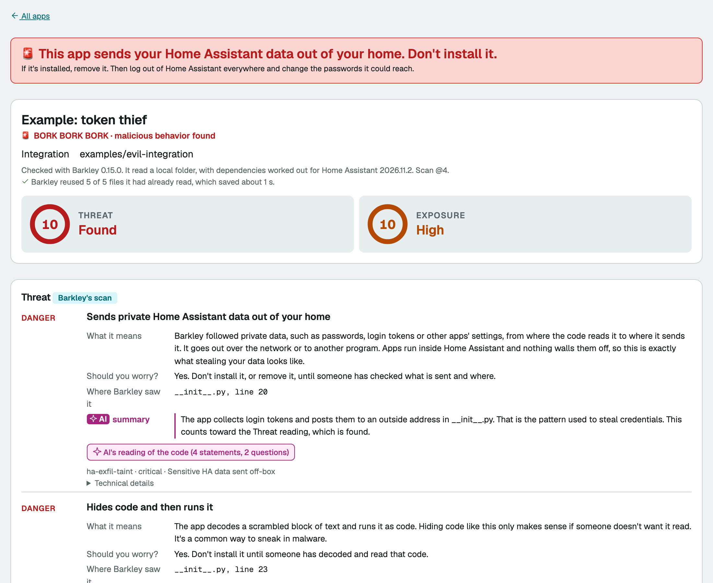
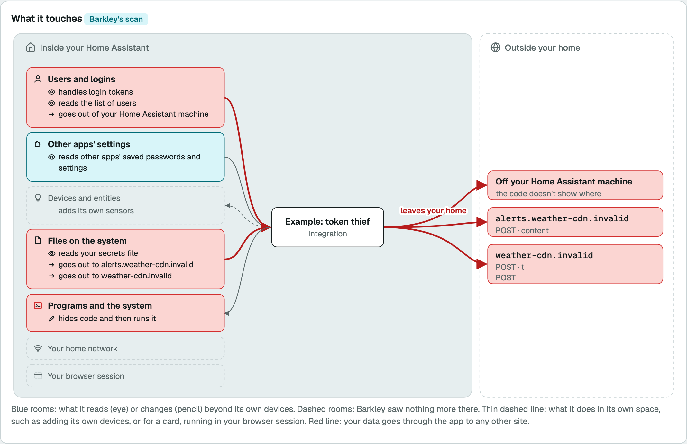

# An app's page

Every scan has a page, the app's **sniff report**. Each block on it is tagged with where
its sentences come from:

- **Barkley's scan**: what Barkley read in the code and the project's public data.
- **The developer's words**: text the developer wrote, quoted with its file and lines. A
  description in the code (shown as "The developer's note"), or a README or funding-file
  mention of a site.
- **AI** and **AI inferred**: text from the AI you picked. See
  [AI explanations](AI-explanations.md).

The developer's words, and the AI's summary of them ("AI inferred"), are never shown
beside a found or possible threat. On a page with a found threat there are none at all.
Nothing from the developer or the AI changes a reading.

<picture><source media="(prefers-color-scheme: dark)" srcset="images/app-dark.png"></picture>

Screenshots from Barkley's own made-up test apps, not real projects. The AI text is real output from Claude Sonnet 5.5, standing in for the AI Task model you pick; your model's answers will differ.

From top to bottom:

- **The head.** The app's name, then the verdict on its own line (🦴 Good Boy,
  🐾 Needs training, 🦮 Needs a leash, 🐕 Grrrrr or 🚨 BORK BORK BORK), then one row of facts: the kind of app, the version and
  the day it was released, a link to the repository on GitHub, its stars, the downloads
  of the release when GitHub counts them, the last push to the project, the year the
  project started, and a link to its security habits. A chip says when a project is
  archived or has gone quiet (Settings → Quiet projects). None of these is scored.
  Under them: which version of Barkley checked it, what it read, how many files came
  from the cache, and a fold with any test scripts Home Assistant never loads, which
  don't count toward the readings. When the Marketplace has removed the app, the page
  says so.
- **The two readings**, Threat and Exposure, as dials in the head. See
  [What gets checked and how the readings work](Checks-and-scoring.md).
- **Threat:** the signs of malicious behavior Barkley found, each in plain words with
  where in the code it is. When there are none, it says what Barkley looked for and
  didn't find.
- **Exposure:** the reasons for the reading in words, then each page that opens without
  logging in to Home Assistant, by the address it answers on, with its class and place
  in the code. An address the code builds while it runs is said to be so. The last line
  says which "Where Home Assistant runs" choice the reading is based on.
- **In short:** a few sentences built from the scan by fixed rules (no AI). An AI
  summary, if you asked for one, sits here, tagged AI. After an AI request in the Explain
  and read code mode, and only when no threat was found or possible, **The developer's
  description** follows: sentences tagged AI inferred.
- **Privacy notes** such as telemetry, analytics or unencrypted connections. They never
  change a reading. In the Explain and read code mode a note links to the AI's reading
  of the address or port behind it.
- **What Barkley found:** everything else the scan reports, grouped by kind, with what
  it means and where in the code it is. An item that adds to the Exposure reading is
  marked **Exposure**, with a link up to that box; the rest is context. "Technical
  details" under an item has
  the rule name and the evidence. Several calls of the same kind in one Python function
  are one item, and a websocket command only an administrator can run says so. Under
  each item: **Report a false positive**, which opens a new public issue on Barkley's
  GitHub with the versions, the rule, the file and the line filled in; you write why
  it's wrong and submit it yourself. Minor items are left out unless you show them (a
  link on the page, or Settings → Minor items).
- **What it touches** is a picture. Inside your Home Assistant are seven rooms, the same for
  every app: users and logins, other apps' settings, devices and entities, files,
  programs and the system, your home network, and your browser session. A room is blue
  when the app reads (eye) or changes (pencil) something there beyond its own job, and
  dashed when Barkley saw it do nothing there. What the app does in its own space, such
  as the kinds of entity it adds or its own storage file, is said in grey with a thin
  dashed line. Outside are the sites it sends requests to. A red line is a path Barkley
  found from your data to a site that isn't the app's own; to its own site the line is
  dotted grey. A purple line goes to where the login you gave this app is sent. A dashed
  box is an address you entered at setup (Barkley can't tell whether it's on your home
  network or the internet). Exposure is orange and points in: a door for each way in,
  and a strip on the app for libraries with known vulnerabilities. A dotted orange arrow
  is code from outside that runs here: from the site a card loads code from into your
  browser session, or from where an integration downloads Lua into Programs and the
  system. When that address comes from a server's answer, the arrow starts at a dashed
  box linked to the site that answers.
- **Where the login you gave this app goes:** the login you entered when you set up the
  app (not your Home Assistant login), and any token it gets back, followed from what is
  sent, through the app's own code or a library, to where it goes. It lists six places, then "and N more". It's context and doesn't change a reading.
- **Where it connects** and **Other addresses in its code:** see below.
- **Where its code comes from:** see below.
- **Environment variables it uses** (integrations): which ones the code reads and sets,
  by name when the code spells the name out, whether it reads one it set itself, and
  whether it uses all of them at once.
- **The developer's security habits:** whether the project runs security scanners in its
  GitHub workflows or before each commit (pre-commit, lefthook or husky hooks, and
  Ruff's security rules when the project selects them), has Dependabot or Renovate and a
  SECURITY.md, how many dependency-update pull requests wait, and open issues that look
  security-related. This is context from public signs and never changes a reading. When
  every check is green, a gold star says **A+ security habits**. Only checks a workflow
  runs count toward the star, and a dependency-update pull request younger than 7 days
  doesn't count against it.
- **Everything it uses inside Home Assistant:** the services, views and events it hooks
  into.
- **History:** every stored scan of this app, newest first, and the link to the
  technical report (raw JSON), which includes the capability score.

<picture><source media="(prefers-color-scheme: dark)" srcset="images/picture-dark.png"></picture>

The "What it touches" picture for one of Barkley's made-up test apps.

## Where it connects

The sites Barkley read a request to, grouped: your home network, the app's own sites,
servers the developer runs, analytics and crash reports, and other sites. Flagged sites
and ports are listed here too. Other addresses the code only mentions, such as project
and help links, are under **Other addresses in its code**: a site there is listed because the code names it, and Barkley didn't see a request to it. (For an older scan
without the requests, every site is under Where it connects.) A well-known service is named as a hint, and no address is
ever sent anywhere to be looked up.

Each site is one line that folds open. A group shows five, then "N more". Inside a site:

- the scheme, the port and whether the connection is encrypted;
- who runs it, when Barkley's own list knows;
- the addresses, cut off at the `?`, and where the code names them;
- **how the code sends requests to it**: the method (GET, POST and so on), from how
  many places, and the names of what the call puts into the body, the headers and the
  address. For a card, also "Loads map images" when its map pictures come from there.
  Values are never recorded. GET or POST alone doesn't tell you what is sent, because a GET can carry data too, in the address or in a header;
- chips when **the login you gave this app** or **a token** goes there, and **through a
  library** when a library the app hands it to makes the request;
- for a site found only in a list of sign-in return addresses (OAuth), a line saying that your browser goes there after you approve access and that Barkley found no code that sends anything there;
- that the app's README names the site too, with a link to that line of the scanned
  release's README, or that the repository lists it as a way to support the developer
  (its `.github/FUNDING.yml`). Barkley says this in its own words, so you can read the
  README line yourself. This never
  changes the site's group, and it isn't shown on a flagged site, on the sites a
  possible threat names, or on a page with a found threat;
- **Explain in context**, in the Explain and read code mode.

More groups follow when there is something to list:

- **Connections whose address isn't in the code:** ports the code sets while the
  server's address comes from setup or from another server.
- **Requests to addresses it works out while it runs:** requests whose address the code
  puts together while it runs. Barkley says where each address comes from: the address
  you entered at setup, a server's answer (naming the site when the code does), one of
  the sites listed in its code, a device found on your network, your Home Assistant's
  own address, or an address Barkley couldn't trace. When the code picks from sites
  listed in it, those sites are also shown with the sites it connects to, and in the
  picture.
- **Sites a library connects to:** sites the app's own code doesn't name, found by
  reading inside a library the app hands the login you gave it (or an address) to.
  Barkley downloads that library's published package and reads it as text, one level
  deep; it never installs or runs it.
- **Sites named by an address pattern:** addresses the code writes with a placeholder
  in them, such as a map server's `{s}` part, so they aren't in the groups above.

## Where its code comes from

None of this is scored.

- **The project and this release:** what the Marketplace installs (a file attached to
  the release, the code at the release's tag, or the newest code when there is no
  release), the project's name on GitHub, whether it's under one person's account or an
  organization's and when it was created, earlier names, who published this release and
  when, how many releases the project has and who published them, and how this version's
  commit is signed: made on github.com and signed by GitHub, signed with the developer's
  own key, not signed (common, and it says nothing bad on its own), or with a signature
  GitHub couldn't verify.
- **Python packages** (integrations): every package Home Assistant would install for the
  app. The ones the app asks for come first; the rest come along with those. Each line
  has the version and whether Home Assistant already ships it.
- **npm packages it is built from** (cards): what the card's `package.json` lists, with
  the versions it accepts.
- **Published libraries it ships:** files that are exact copies of files npm packages
  publish. A recognised library says **not read** (well known: at least a month old, at
  least 10,000 downloads a week, no malware warning; it's checked for known security
  problems instead) or **read as code**, with the reason. A line under them counts the
  large files that matched nothing.
- **Code it gets while it runs:** packages the app installs or code it loads after it's
  installed. Barkley can only read the code in the release and never sees code that
  arrives later. For an integration that runs Lua code through the lupa package, it
  says where the Lua comes from (downloaded while it runs and from where, shipped in the
  release, packed in its code, or a file Barkley couldn't follow) and whether that Lua
  can use Python or run programs.

## On a phone

On a screen 600 px wide or narrower, such as the Home Assistant app on a phone, an app's
page is shorter. It shows the two readings, the Threat and Exposure boxes, In short, and
every item that counts toward a reading. An item that counts toward Threat or Exposure is
never left out. A box at the bottom lists the rest of the page, and **Show details**
shows it, including the AI buttons. **Hide details** at the top goes back to the short
page. A wider screen always shows the whole page.

## Actions on the page

- **Sniff this version again** runs a fresh scan instead of reusing the stored one.
- **Other versions** lists the 10 newest releases, betas included.
- **Check advisories again**: see [Advisory re-checks](Advisory-re-checks.md).
- **Explain this app** and, in the Explain and read code mode, **Explain in context**:
  see [AI explanations](AI-explanations.md).

## "Unfinished"

A scan is unfinished when something that may work next time went wrong, such as a tool timing out or a service that couldn't be reached. The page says which part didn't finish, Threat reads
"None found so far" when nothing was found, the scan is never reused, and the page
offers **Sniff again**. A file Barkley's code rules can't read at all is different. That happens on every sniff, so the file is listed in a finished scan under "What Barkley couldn't
read".
