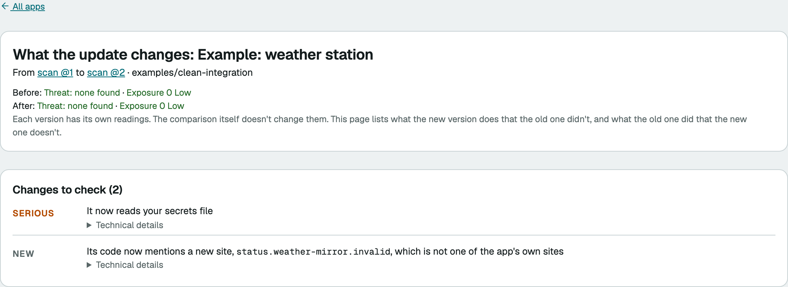

# What an update would change

An update is new code from the same project, so Barkley shows what the new version does that the old one didn't.

## How

- **Check update** on an installed app that has an update waiting. Barkley scans the
  offered version, reuses the stored scan of the version you run (or scans it first),
  and shows the comparison.
- Auto-sniff does the same on its own as soon as the Marketplace offers an update, so
  the comparison is usually there before you look. See
  [Auto-sniff and notifications](Auto-sniff-and-notifications.md).
- **What would updating change?** on the first page does it for any repository and tag.

The first check of an app takes a few minutes, because two versions may need scanning.
The status box shows progress.

## Reading the comparison

- The top shows the readings **Before** and **After**. Each version has its own
  readings; the comparison itself doesn't change them.
- **Changes to check** lists the few changes that matter, most important first: new
  threats and other new items rated medium or higher, new data flows, a new publisher, new sites that aren't
  the app's own. When there are none, **In short** says "Nothing important changed."
- **Smaller changes** folds everything else into one line you can open. None is a
  concern on its own.

<picture><source media="(prefers-color-scheme: dark)" srcset="images/update-dark.png"></picture>

Screenshots from Barkley's own made-up test apps, not real projects. The AI text is real output from Claude Sonnet 5.5, standing in for the AI Task model you pick; your model's answers will differ.

## What else the update changes

Under the readings, one sentence says what the update adds and removes beyond security:
actions you can use in automations, kinds of entity, pages and sidebar pages, commands
and webhooks it accepts, other integrations' actions it calls, packages it requires (and
the ones that come with them), sites it sends requests to, sites the login you gave it
goes to, and environment variables it reads. **Which ones** names them. A package that
only changes version isn't counted.

Barkley counts kinds of entity (switches, sensors) rather than entities, because how many entities an app creates depends on your devices. An update notification carries
the same sentence with counts only, never names. Both versions must be sniffed by 0.15
or later; otherwise the page says so. None of this changes a reading or the changes to
check.

## What it also tells you since 0.15

These come from facts a scan keeps since 0.15, so both versions must have been sniffed
by 0.15 or later.

- **How the release's commit is signed.** A release whose commit is no longer signed, or
  is signed in a different way than before (by GitHub, or with the developer's own key),
  is a change to check. Signing that starts is a smaller change.
- **Requests** (integrations and cards): the new version sends a kind of request (GET, POST and so
  on) to a site that the old one didn't, or puts new names into the body, the headers or
  the address of a request it already sent.
- **Environment variables** (integrations): the new version reads or sets one the old
  one didn't, or starts using all of them at once.
- **Published libraries copied into the app:** a new one, a changed version, or one that
  Barkley recognised before and now reads as code.
- **Test scripts Home Assistant never loads:** a change in one is listed, but it's never
  a change to check.

Requests, environment variables and published libraries are listed for information. They go under the smaller changes and never send a notification on their own.
