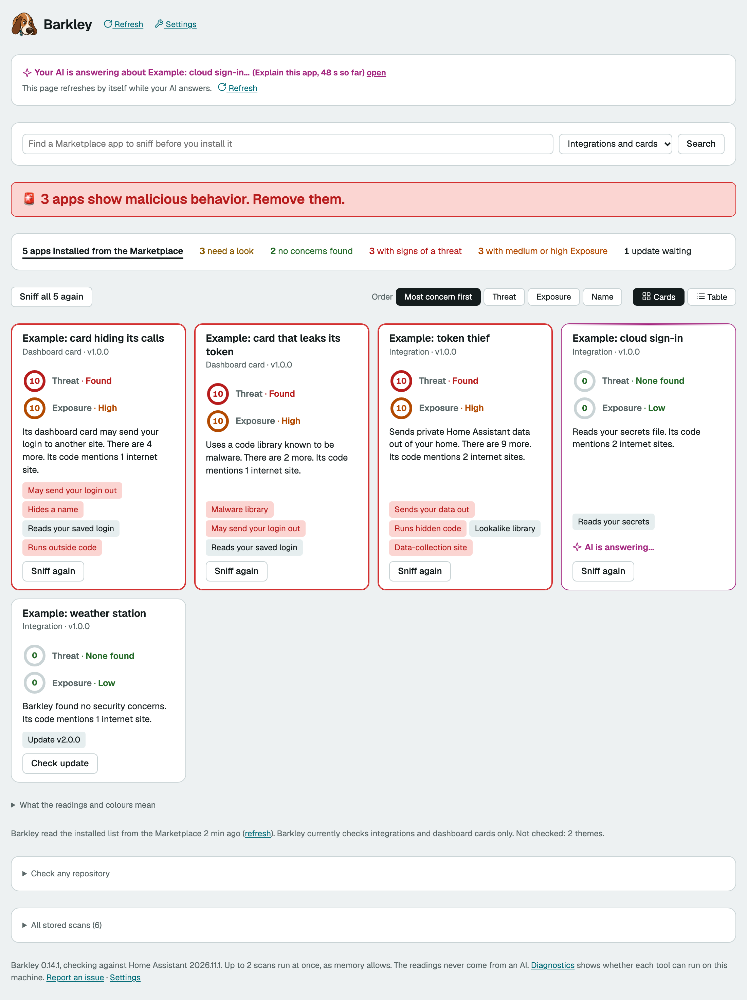

# The list

Barkley's first page shows what you have installed through the Marketplace, with the
version you run and the version the Marketplace would install now. Each app shows its
two readings, Threat and Exposure.

<picture><source media="(prefers-color-scheme: dark)" srcset="https://raw.githubusercontent.com/SeriesOfTubez/ha-barkley/main/docs/images/list-dark.png"></picture>

Screenshots from Barkley's own made-up test apps, not real projects. The AI text is real output from Claude Sonnet 5.5, standing in for the AI Task model you pick; your model's answers will differ.

## What comes first

By default (Order: Most concern first) apps that weren't checked yet come first, then
the ones that need a look, then the rest. Within each, the highest Threat comes first,
then the highest Exposure. The Order menu can also sort by Threat, by Exposure (highest
first, not-checked apps last) or by name.

An app needs a look when the version you'd run has a found or possible threat or High
exposure, when its check didn't finish, or when a checked update brings a change to
check. When any installed app has a found threat, one sentence at the top of the list
says so.

## Filters, views and pages

- The counts at the top are filters: needs a look, with signs of a threat, with medium
  or high Exposure, no concerns found, with privacy notes, updates waiting, and not
  checked. A filter shows when its count isn't 0.
- Switch between **cards** (12 per page) and a **table** (25 per page). Barkley
  remembers the view.
- "What the readings and colours mean" under the list is the legend:

| Outline | Means |
|---|---|
| red | a threat found |
| yellow | a possible threat |
| orange | High exposure |
| none | no concerns found |
| dashed grey | not checked |

On a card, only a threat's chip is red, and "Removed as critical" when the Marketplace
removed the app for that; the other chips are neutral ("Removed from the Marketplace",
"Pre-release", a quiet or archived project, "Sniffed with earlier rules", an update to
check). A purple chip marks a privacy note. Privacy notes never change a reading.

## Buttons

- **Sniff it** on an app scans the version you have installed; **Sniff again** runs a
  fresh scan of it instead of reusing the stored one.
- **Check update** scans the offered version and shows what the update would change. See
  [What an update would change](Update-comparison).
- **Sniff N apps not yet sniffed with the current rules** scans every installed app that
  has no scan with Barkley's current rules. A Barkley update keeps its stored scans
  unless it changed what a scan finds (its rules, its checks or the scanner tools).
  **Sniff N unfinished again** repeats every scan that didn't finish. When every app has a scan,
  **Sniff all N again** runs a fresh scan of each, one after another (the memory guard
  still checks each one). Apps already queued or running are skipped.

A button brings you back to the page, filter and view you clicked it on.

## While something runs

A status box at the top shows what is being sniffed, what is queued and what just
finished, and the page reloads itself every 5 seconds until the work is done. The panel
uses no JavaScript, so that reload is how progress is shown.

## Further down

- **Sniffed, not installed:** apps you sniffed from search. Their scans are deleted
  after 7 days unless you install the app. One sniffed with earlier rules is marked so,
  with a button to sniff it again (and one for all of them).
- **Check any repository:** sniff a repository by name, at the release the Marketplace
  would install or at a tag you give.
- **What would updating change?** for a repository and tag you name.
- **All stored scans** and the **Jobs** table.
- The search box, and the links to **Diagnostics**, **Report an issue** (a new public
  issue on Barkley's GitHub with the versions filled in) and **Settings**.
